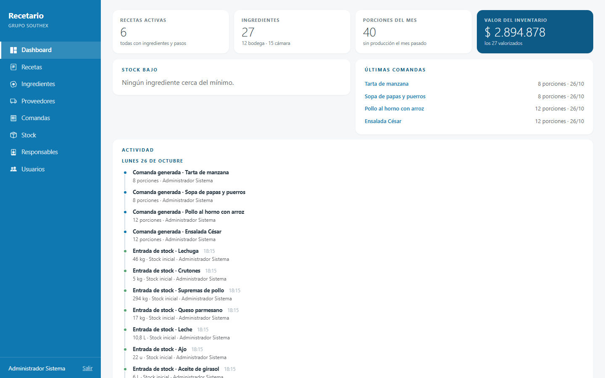
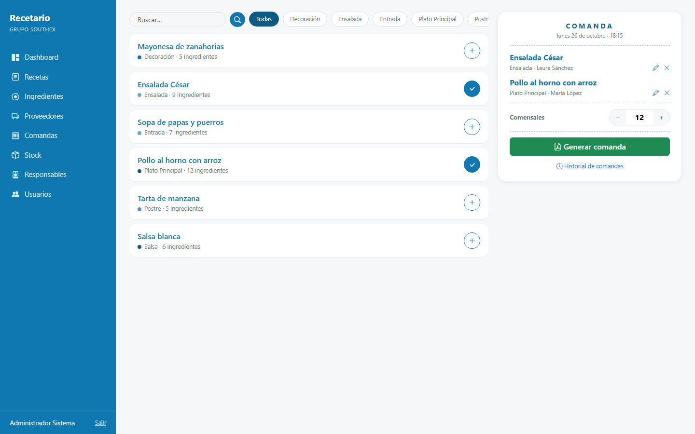
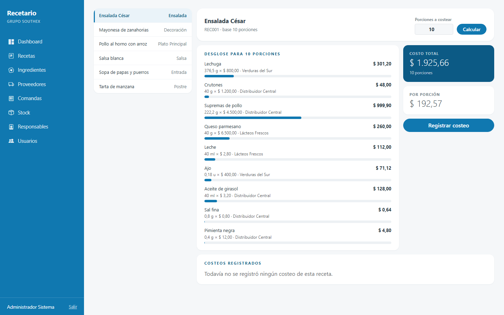
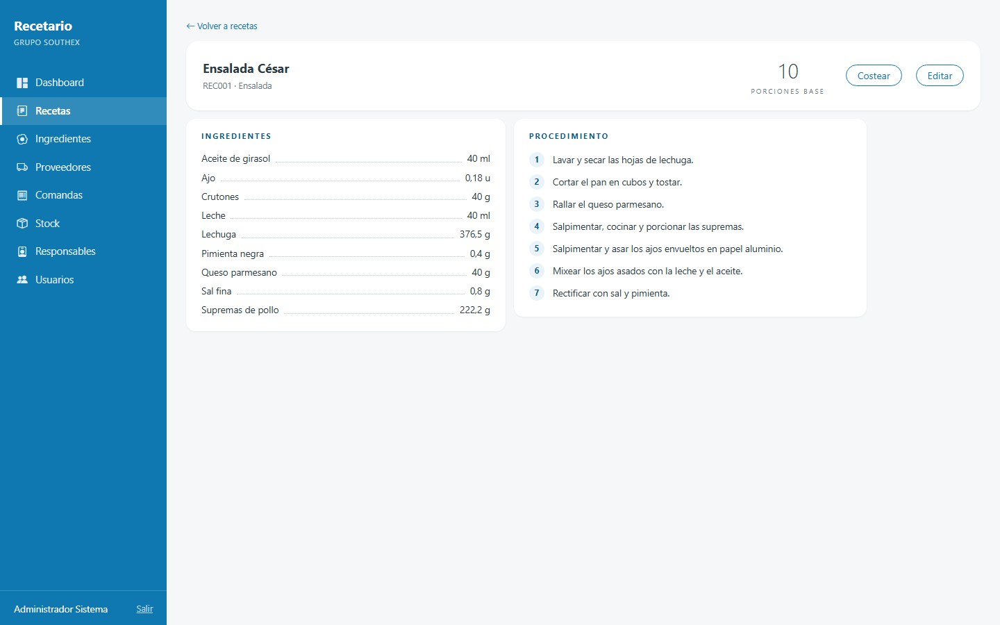
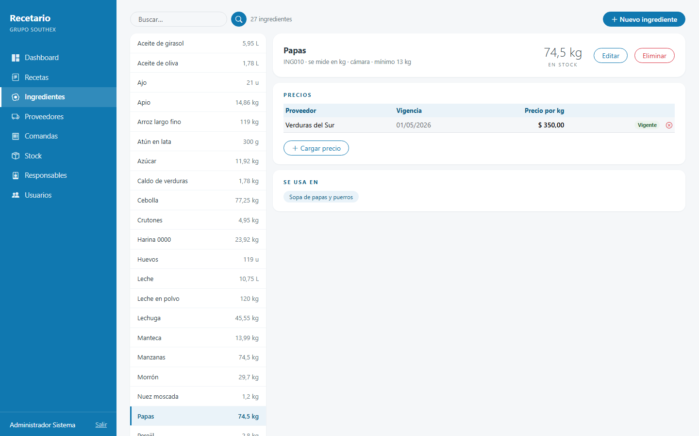
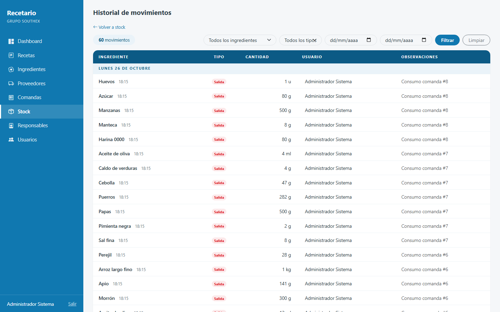
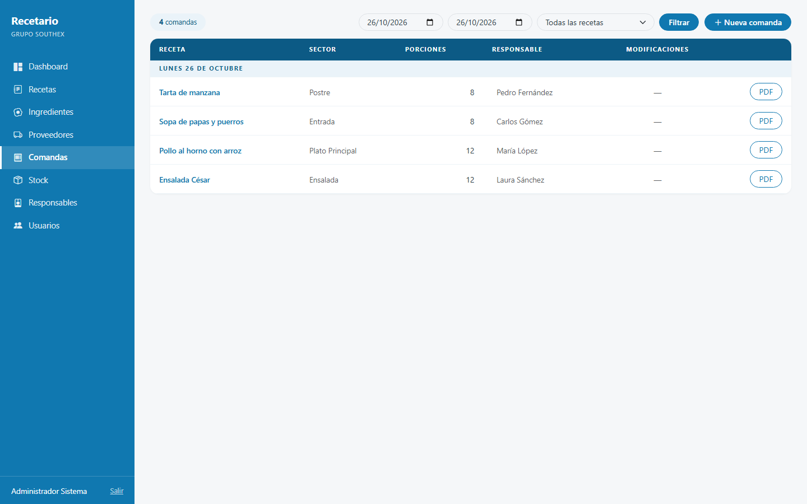
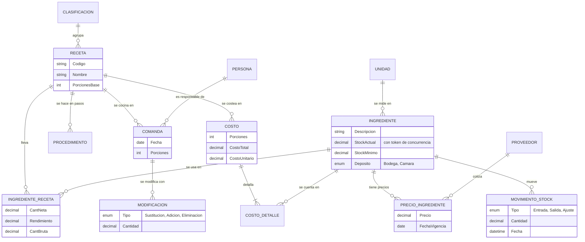
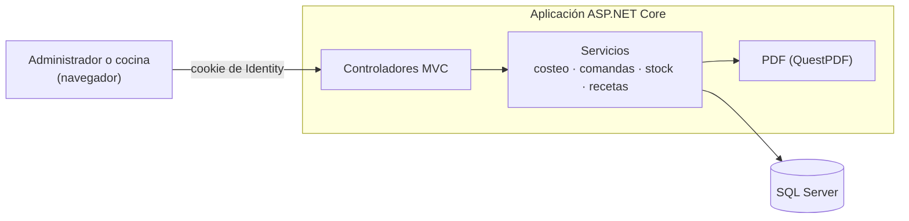

# Recetario

Sistema de recetas, costeo y comandas para cocina. Nació como trabajo práctico en WinForms y se migró a ASP.NET Core MVC.

## Funcionalidades

- **Costeo de recetas**: calcula el costo con el precio vigente de cada ingrediente, escalado a las porciones que se necesiten, y lo exporta a PDF.
- **Comandas con stock automático**: se elige la receta y los comensales, se pueden sustituir, sumar o sacar ingredientes, y el stock se descuenta solo. La comanda sale en PDF.
- **Stock auditado**: cada entrada, salida o ajuste queda como un movimiento con usuario y fecha, y el dashboard avisa qué ingredientes están por agotarse.
- **Ingredientes y proveedores** con el historial de precios de cada uno.
- **Dos perfiles**: administrador y cocina, con permisos distintos.

## Capturas

Una copia local con datos de demostración.

| | | | |
|---|---|---|---|
|  |  |  |  |
| Dashboard con métricas y actividad de stock | Comandera: escala a los comensales y descuenta stock | Costeo escalado por porciones | Receta con su procedimiento paso a paso |
|  |  |  | |
| Ingredientes con stock e historial de precios | Movimientos de stock, filtrables y auditados | Historial de comandas | |

## Stack

.NET 9 · ASP.NET Core MVC · EF Core 9 (code-first, Fluent API) · SQL Server · ASP.NET Core Identity · Bootstrap 5 · QuestPDF · xUnit · Docker Compose · GitHub Actions.

## Modelo de datos

Cada ingrediente de una receta lleva su cantidad neta, su rendimiento y su cantidad bruta. Cada costeo guarda su propio detalle con el costo unitario que se usó, así que un cambio de precio posterior no lo altera. Los usuarios del sistema son las tablas de ASP.NET Core Identity.

## Arquitectura

## Decisiones técnicas

- **Stock a prueba de comandas simultáneas.** Se valida dentro de la transacción y con un token de concurrencia: si dos comandas lo tocan a la vez, EF lo detecta y reintenta con el valor nuevo.
- **Un solo reloj con la hora de Argentina.** La aplicación pregunta la hora a un `TimeProvider` y no a `DateTime.Now`, porque un servidor en la nube corre en UTC, tres horas adelantado.
- **La lógica en servicios y los controladores delgados**, con interfaces e inyección de dependencias.
- **Sin claves en el repositorio.** La del administrador sale de user-secrets o de una variable de entorno; si falta, la aplicación no arranca.
- **Migrada con la referencia delante.** Los scripts SQL del sistema original se conservan y los servicios se verificaron contra ellos.

El porqué de cada una está en [`docs/decisiones-tecnicas.md`](docs/decisiones-tecnicas.md).

## Tests y CI

141 tests de xUnit sobre costeo, comandas, stock (incluida la concurrencia), dashboard y el manejo de la hora. Corren en cada push con GitHub Actions.

## Autor

- Estudiante de la Tecnicatura Universitaria en Programación - UTN FRGP
- Email: [facundo.rra@gmail.com](mailto:facundo.rra@gmail.com)
