# Modelo de datos

Diagrama entidad-relación de Recetario, armado a partir del modelo de EF Core (el último snapshot de las migraciones). Muestra las quince tablas del negocio y las tres de ASP.NET Core Identity que la aplicación usa para los usuarios y sus roles.

```mermaid
erDiagram
    ASPNETROLES ||--o{ ASPNETUSERROLES : "se asigna en"
    ASPNETUSERS ||--o{ ASPNETUSERROLES : "tiene"
    PERSONA ||--o{ COMANDA : "es responsable de"
    RECETA ||--o{ COMANDA : "se cocina en"
    ASPNETUSERS ||--o{ COMANDA : "genera"
    RECETA ||--o{ COSTO : "se costea en"
    ASPNETUSERS ||--o{ COSTO : "calcula"
    COSTO ||--o{ COSTO_DETALLE : "detalla"
    INGREDIENTE ||--o{ COSTO_DETALLE : "se cuenta en"
    UNIDAD ||--o{ INGREDIENTE : "mide"
    COMANDA ||--o{ INGREDIENTE_COMANDA : "se cocinó con"
    INGREDIENTE ||--o{ INGREDIENTE_COMANDA : "se usó en"
    UNIDAD ||--o{ INGREDIENTE_COMANDA : "mide"
    INGREDIENTE ||--o{ INGREDIENTE_RECETA : "se usa en"
    RECETA ||--o{ INGREDIENTE_RECETA : "lleva"
    UNIDAD ||--o{ INGREDIENTE_RECETA : "mide"
    COMANDA ||--o{ MODIFICACION : "se modifica con"
    INGREDIENTE |o--o{ MODIFICACION : "se sustituye en"
    INGREDIENTE |o--o{ MODIFICACION : "reemplaza en"
    UNIDAD ||--o{ MODIFICACION : "mide"
    INGREDIENTE ||--o{ MOVIMIENTO_STOCK : "mueve"
    UNIDAD ||--o{ MOVIMIENTO_STOCK : "mide"
    ASPNETUSERS ||--o{ MOVIMIENTO_STOCK : "registra"
    CLASIFICACION |o--o{ PERSONA : "clasifica"
    INGREDIENTE ||--o{ PRECIO_INGREDIENTE : "tiene precios"
    PROVEEDOR ||--o{ PRECIO_INGREDIENTE : "cotiza"
    RECETA ||--o{ PROCEDIMIENTO : "se hace en pasos"
    CLASIFICACION ||--o{ RECETA : "agrupa"

    ASPNETROLES {
        nvarchar(450) Id PK
        nvarchar(max) ConcurrencyStamp
        nvarchar(256) Name "Admin, Cocina"
        nvarchar(256) NormalizedName UK
    }
    ASPNETUSERROLES {
        nvarchar(450) UserId PK, FK
        nvarchar(450) RoleId PK, FK
    }
    ASPNETUSERS {
        nvarchar(450) Id PK
        nvarchar(256) UserName
        nvarchar(256) Email
        nvarchar(max) PasswordHash "PBKDF2"
        nvarchar(max) Nombre
        nvarchar(max) Apellido
        datetimeoffset LockoutEnd "bloquea al usuario"
    }
    CLASIFICACION {
        int IdClasificacion PK
        nvarchar(100) Nombre UK
    }
    COMANDA {
        int IdComanda PK
        date Fecha
        int IdPersona FK
        int IdReceta FK
        int Porciones
        nvarchar(450) UsuarioId FK
    }
    COSTO {
        int IdCosto PK
        decimal CostoTotal "precisión (12,4)"
        decimal CostoUnitario "precisión (12,4)"
        date Fecha
        int IdReceta FK
        int Porciones
        nvarchar(450) UsuarioId FK
    }
    COSTO_DETALLE {
        int IdCostoDetalle PK
        decimal CantBruta "precisión (10,4)"
        decimal CostoUnitario "precisión (12,4)"
        int IdCosto FK
        int IdIngrediente FK
        decimal Subtotal "precisión (12,4)"
    }
    INGREDIENTE {
        int IdIngrediente PK
        nvarchar(20) Codigo UK
        int Deposito "1 Bodega, 2 Cámara, por defecto 1"
        nvarchar(100) Descripcion
        int IdUnidad FK
        decimal StockActual "precisión (10,4), con token de concurrencia"
        decimal StockMinimo "precisión (10,4)"
    }
    INGREDIENTE_COMANDA {
        int IdIngredienteComanda PK
        decimal Cantidad "precisión (10,4), ya escalada y con las modificaciones aplicadas"
        int IdComanda FK
        int IdIngrediente FK
        int IdUnidad FK
    }
    INGREDIENTE_RECETA {
        int IdReceta PK, FK
        int IdIngrediente PK, FK
        decimal CantBruta "precisión (10,4)"
        decimal CantNeta "precisión (10,4)"
        int IdUnidad FK
        decimal Rendimiento "precisión (5,2), porcentaje, de 1 a 100"
    }
    MODIFICACION {
        int IdModificacion PK
        decimal Cantidad "precisión (10,4)"
        int IdComanda FK
        int IdIngredienteOriginal FK "nulo en una adición"
        int IdIngredienteReemplazo FK "nulo en una eliminación"
        int IdUnidad FK
        int Tipo "1 Sustitución, 2 Adición, 3 Eliminación"
    }
    MOVIMIENTO_STOCK {
        int IdMovimiento PK
        decimal Cantidad "precisión (10,4)"
        datetime2 Fecha
        int IdIngrediente FK
        int IdUnidad FK
        nvarchar(255) Observaciones "nulo"
        int Tipo "1 Entrada, 2 Salida, 3 Ajuste"
        nvarchar(450) UsuarioId FK
    }
    PERSONA {
        int IdPersona PK
        nvarchar(100) Apellido
        nvarchar(150) Email "nulo"
        int IdClasificacion FK "nulo"
        nvarchar(100) Nombre
        nvarchar(20) Telefono "nulo"
    }
    PRECIO_INGREDIENTE {
        int IdPrecio PK
        date FechaVigencia
        int IdIngrediente FK
        int IdProveedor FK
        decimal Precio "precisión (12,4)"
    }
    PROCEDIMIENTO {
        int IdProcedimiento PK
        nvarchar(max) Descripcion
        int IdReceta FK
        int NroPaso
    }
    PROVEEDOR {
        int IdProveedor PK
        nvarchar(100) Contacto "nulo"
        nvarchar(255) Direccion "nulo"
        nvarchar(150) Email "nulo"
        nvarchar(100) Nombre
        nvarchar(20) Telefono "nulo"
    }
    RECETA {
        int IdReceta PK
        bit Activo
        nvarchar(20) Codigo UK
        int IdClasificacion FK
        nvarchar(100) Nombre
        int PorcionesBase
    }
    UNIDAD {
        int IdUnidad PK
        nvarchar(10) Abreviatura UK
        nvarchar(50) Nombre UK
    }
```

## Restricciones

| Qué | Dónde | Para qué |
|---|---|---|
| Únicos | `CLASIFICACION.Nombre`, `INGREDIENTE.Codigo`, `PROCEDIMIENTO.IdReceta, NroPaso`, `RECETA.Codigo`, `UNIDAD.Abreviatura`, `UNIDAD.Nombre` | Un código, un nombre o una abreviatura no se repiten; una receta no tiene dos veces el mismo paso |
| `CHECK` en las cantidades, los precios y las porciones | `COMANDA`, `COSTO`, `INGREDIENTE_RECETA`, `MODIFICACION`, `MOVIMIENTO_STOCK`, `PRECIO_INGREDIENTE`, `PROCEDIMIENTO`, `RECETA` | Siempre mayores que cero. La única excepción es el movimiento de ajuste, que admite cero ("conté y no queda nada") |
| `CHECK (StockMinimo >= 0)` | `INGREDIENTE` | El stock mínimo no puede ser negativo |
| `CHECK (Rendimiento > 0 AND Rendimiento <= 100)` | `INGREDIENTE_RECETA` | El rendimiento es un porcentaje |
| Token de concurrencia en `StockActual` | `INGREDIENTE` | Si dos comandas tocan el stock a la vez, EF lo detecta y reintenta |
| Claves foráneas con `ON DELETE RESTRICT` | Todas, salvo las de abajo | La base no deja borrar algo que tiene historial |
| `ON DELETE CASCADE` | `COSTO_DETALLE` → `COSTO`, `INGREDIENTE_COMANDA` → `COMANDA`, `INGREDIENTE_RECETA` → `RECETA`, `MODIFICACION` → `COMANDA`, `PRECIO_INGREDIENTE` → `INGREDIENTE`, `PROCEDIMIENTO` → `RECETA` | Lo que cuelga de una receta, un ingrediente, un costeo o una comanda se va con ella |

Los importes y las cantidades llevan cuatro decimales (`decimal(10,4)` y `decimal(12,4)`), y el rendimiento, dos (`decimal(5,2)`).

Las otras cuatro tablas de Identity (`AspNetRoleClaims`, `AspNetUserClaims`, `AspNetUserLogins` y `AspNetUserTokens`) y las columnas estándar de `AspNetUsers` que no se usan acá se omitieron para que el diagrama se lea.
